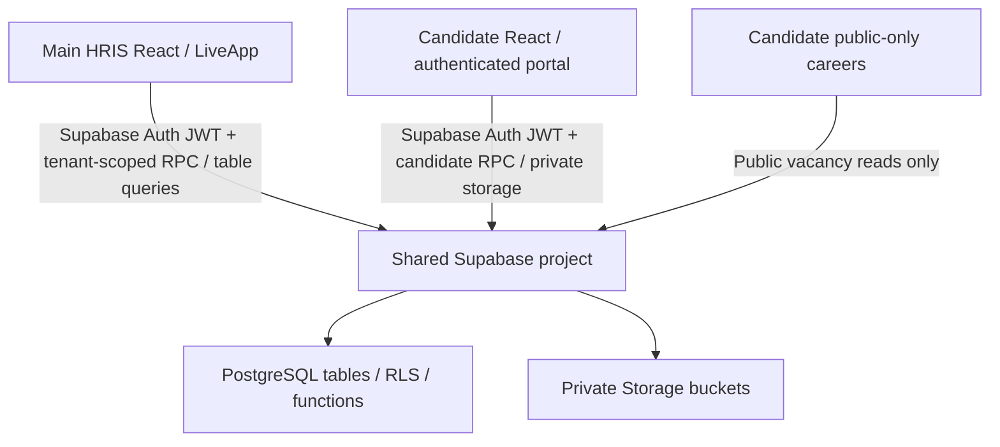

# Phase 01 — Architecture and Main/Candidate integration blueprint

**Blueprint/source contract gate: PASS. Live integration certification: NOT YET PASSED.** This phase establishes an executable, reproducible architecture inventory and the downstream ownership of known gaps. It does not certify the hosted Supabase instance or the 1,047 business requirements.

## Actual running architecture



- **Main entry:** `src/App.tsx` mounts `src/live/LiveApp.tsx`; the original `MainShell` remains a preview surface. Authenticated Main membership/permission resolution reads tenant memberships, linked employees and an admin-user grant, then invokes `has_tenant_permission` and tenant-specific data RPCs. Switching tenants clears cached records. Client-side permissions merely control UI; **PostgreSQL RLS/function grants remain authoritative**.
- **Candidate entry:** the adjacent `HRIS-Candidate-v2/src/App.tsx` mounts authenticated `MainAppContent` unless the build explicitly selects `VITE_CANDIDATE_PUBLIC_ONLY=true` in production, in which case it mounts `PublicOnlyCareers`. `src/lib/api.ts` owns candidate recruitment RPC operations and private candidate-document uploads. Candidate demo data requires development mode *and* `VITE_ENABLE_DEMO_MODE=true`.
- **Backend:** both apps point at the same intended Supabase project, `oslgwxaqfbteqtwqvdzs`, via configurable public keys. Neither application should embed `service_role` credentials. Migrations in **Main** `supabase/migrations` are the proposed versioned SQL contract. `src/sql/contracts.ts` is only an architectural/preview specification, not a migration or a credentialed permission test. The platform tenant provisioning SQL under `supabase/staging/phase2a` and `phase2b` is deliberately **staged**, not versioned for automatic production application.
- **Persistence & identity:** candidate application, assessment, interview, offer, and preboarding records are linked by candidate Auth identity/application ID; HR reads tenant-scoped recruiting data. Conversion reuses the candidate's Auth identity for the linked employee record/membership and is guarded by tenant HR permissions and joining-date/preboarding conditions. No unapproved identity migration, new email provider, or alternate canonical employment identity is assumed.

## Exact frontend→SQL inventory

Read-only command:

```bash
node scripts/phase01-integration-inventory.mjs
node scripts/phase01-integration-inventory.mjs --json
node --test tests/contracts/phase01-integration-inventory.test.mjs
```

Updated 19 October source checkpoint (the original blueprint was 18 October):

| Source-side measure | Count | Interpretation |
| --- | ---: | --- |
| All Main + Candidate RPC callsites | 137 | 135 literal and 2 dynamic dispatch sites; dynamic sites have 6 explicitly accounted-for targets |
| Unique RPC names reachable from the clients | 128 | Duplicated callsites and dynamic target names deduplicated |
| RPC names present in Main versioned `public` SQL function declarations | 119 | **Source definition only**; the 119th source definition was recovered in Phase 06 after inspecting the same already-deployed hosted body |
| RPC names defined **only** in Phase 2A/2B/03 staging SQL | 9 | Seven tenant-administration functions plus two optional-module functions, feature-gated and not published |
| RPC names with no tracked SQL definition | 0 | Initial missing `candidate_submit_requested_document` definition was recovered as a source-only Phase 06 correction |
| Direct `.from()` table-query callsites | 67 | Must separately enforce RLS/grants; these are not RPC names |
| Storage-bucket `.from()` callsites | 23 | Must separately enforce private bucket/object policies |

The `--json` output provides every concrete client path/line, SQL declaration path/line, staged-only source, and unresolved name. This is a **lexical source inventory**, not a full function-signature or SQL AST verifier; its test deliberately fails if a new unaccounted-for dynamic `.rpc()` site appears. Source-declared RPCs can still be missing or incompatible on hosted PostgreSQL.

## Cross-system contract sequence

| Stage | Candidate surface / operation | HRIS source / operation | Boundary that must be proven in a real session |
| --- | --- | --- | --- |
| Published vacancy | Public jobs / verified details / `candidate_apply_to_job` | HR recruitment vacancy publication, tenant pipeline | Public may see only published listings; application write requires authenticated candidate, exact vacancy/tenant identity and immutable submission |
| Candidate journey | `candidate_get_recruitment_context`, interview response, assessment submission, candidate-document uploads | HR candidate pipeline, scheduling, evaluation, document requests | Candidate reads/submits **only their own** application evidence; HR sees only authorized tenant data |
| Offer and preboarding | `candidate_respond_offer_record`, `candidate_save_my_preboarding_step`, `candidate_get_my_preboarding_handoff` | HR issued offer, `hris_get_candidate_preboarding_queue` | Accepted offer and four-section completion verified server-side; no candidate-controlled joining bypass |
| Employee conversion | Candidate reuses Auth account; receives employee entitlement only after HR approval | `hris_activate_candidate_employee` | Active tenant, `employees.manage`, unique employee number, approved joining date, idempotence, audit and cross-tenant denial |
| Employee self-service | HRIS employee sign-in and own workspace | Tenant-explicit self-service RPCs, RLS-protected document/leave/attendance data | No tenant mixing; no direct object/reference change grants another employee's data |
| SaaS tenant lifecycle | Not a Candidate operation | Feature-flagged `platform_hris_*` staging RPCs | Only active platform Super Admin; new tenants remain inactive until tenant-wide security certification |

## Non-negotiable integration invariants

1. **Auth/session:** sign-in tokens obtained through Supabase Auth; only publishable/anon keys in browser. Server checks `auth.uid()` and the live account when needed; revoked/inactive identities denied. Preview and local demo must never become production fallbacks.
2. **Tenant scope:** every privileged read/write checks active membership **and** the selected tenant. A UI filter, `p_tenant_id` argument, or filtered visible card is not authorization. When the client switches identities or tenants, old records must be cleared and stale async results ignored.
3. **Object privacy:** employee HR documents, candidate submissions, application status history, appraisals, receipts and notifications require owner/authorized-person RLS and private Storage policies. Security-definer functions must use an explicitly controlled search path, constrained grants and in-function permission verification.
4. **Transactional workflows:** persisted stage transitions and side effects (history, notices, audit) must be atomic, idempotent where designed, and reject duplicate decisions or invalid transitions. A simulated client state update is not evidence of persistence.
5. **Recovery & usability:** meaningful loading, empty, retry, session-expiry and conflict paths; EN/BN translations, mobile and keyboard operation verified for the same authenticated operations. Preserve Material/Poppins/`#085587` and the approved shell.
6. **Publication:** keep versioned source, staging-only SQL, disposable acceptance and hosted production deliberately distinct. No migration-history rewrite and no direct hosted replay based on matching or differing filenames.

## Dependency and blocker disposition

| Finding | Affected phase | Next safe acceptance action | Status |
| --- | --- | --- | --- |
| Nine feature-flagged platform RPCs reside only in staging SQL | 03 / 04 | Verify the existing tenant-auth suite plus optional-module data/Storage journeys before any promotion; keep inactive-until-certified guard | STAGED_BY_DESIGN |
| `candidate_submit_requested_document` initially lacked versioned source, despite already existing hosted with the exact `p_request_id,p_file_name,p_file_path` signature | 06 | **Recovered the hosted body as versioned source** in `20261018120000_candidate_requested_document_source_recovery.sql` with matching owner checks/grants. The older Candidate prose's `p_payload` signature is stale. Disposable execution and migration provenance remain release gates | SOURCE_GAP_CLOSED; TEST/PROMOTION_OPEN |
| Hosted API and RLS Gate B reports 0/25 source-parity assertions passing | 04 / 05 / 08 / 19 | Reconcile function signatures, prerequisite objects, migration provenance, grants and policy predicates in dependency order on disposable Postgres before considering hosted change | BLOCKED_LIVE_PARITY |
| Hosted/checked-in migration version histories differ | 19 / 21 | Compare deployed catalog semantics and provenance; neither replay all 98 migrations nor rewrite 111 hosted history entries | OPEN_PROVENANCE |
| Canonical story completion evidence remains incomplete | 20 | Map every original requirement to its actual tested journey and independently reassess the historical 82 aggregate | OPEN_ACCEPTANCE |
| Full Figma pixel/accessibility certification not yet recorded | 02 / 18 / 21 | Compare captured actual screen states at matched Figma breakpoints and routes | OPEN_UI_PARITY |

The design and source-contract inventory are **Phase 01 deliverables**; these recorded integration blockers must be resolved in their actual implementation/security phases before Phase 21. No hosted schema, code publication, Candidate source, permissions or production data changed as part of this blueprint.
