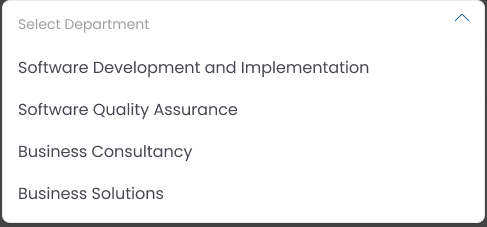

# WS07 HR UI parity audit — Batch 1: Organization Structure

**Status:** Partial audit; no visual mismatch confirmed. This batch does not establish 100% parity.

**Scope:** HR03 organization screens only, within WS07’s HR02–HR33 ownership. HR01 remains excluded. The HR03 acceptance rows and their disposition were checked against the canonical register at commit [`dcdd89ba140cd92ace71130b4eab439525e07594`](https://github.com/shihab-tech04/HRIS-v2/blob/dcdd89ba140cd92ace71130b4eab439525e07594/docs/audit/HRIS_1047_Story_Classification_Register_2026-10-20.csv). At audit start, PR [#43](https://github.com/shihab-tech04/HRIS-v2/pull/43) was open and draft at head `c6f912dec4f892de96a4bf9376c3428bc210890e`; its base and the live `development/hris-checkpoints` head were `1714a08e24f47999618b0127fc818a3d19eb187a`. This docs-only audit update is on the PR branch at `97bbb693c40773fc0e50989c533a12219b6c3ecd`. The implementation source and focused tests were inspected/run from local checkout `d5fbaa0b421b6fd9282dc66697280160d12d4db0`.

## Screen inventory and disposition

| Implemented screen and route | Related canonical story IDs | Figma screen/frame ID | Result | Severity |
| --- | --- | --- | --- | --- |
| Legacy preview: **Org Structure & Roles**, SPA tab `admin_org_roles` at `/`; rendered by `src/App.tsx` and `src/views/admin/OrgStructureAndRoles.tsx`. The department UI remains in-memory. | `HR03-03` (department section). The dynamic-role UI has no confirmed story-level equivalent in HR03. | **No approved mapping.** Closest candidate inspected: `86:36133` “Department Lists,” inside Figma section “Requisition.” It is a dropdown options frame, not this screen. | `NO_APPROVED_FIGMA_MAPPING`; no mismatch can be asserted. | N/A |
| Authenticated tenant workspace: **Teams**, in-app page ID `teams` under the root route; permission-gated navigation and component mount are in `src/live/LiveHrisWorkspace.tsx`, with UI in `src/live/OrganizationTeams.tsx`. | `HR03-05` (manage teams). | **No approved mapping.** Candidate `86:36133` is not a Teams management screen. | `NO_APPROVED_FIGMA_MAPPING`; no mismatch can be asserted. | N/A |

All nine HR03 register rows (`HR03-01` through `HR03-09`) say that no canonical story-ID reference was found in reviewed Figma metadata. The rows remain classified `BLOCKED`; that does not prove the features are absent. No legal-entity, reporting-line, position, grade/band, hierarchy, or effective-dating design semantics are inferred here.

## Figma evidence

The approved file has one page, `Page 1` (`0:1`). Exact visible-label searches for the two implementations’ organization headings, filters, actions, and controls found no matching screen frame. The closest organization-related result is node [`86:36133`](https://www.figma.com/design/XEXLe9J1oATlITS9I5u1P9?node-id=86-36133), named “Department Lists,” under the “Requisition” section (`86:33843`). Its screenshot is preserved below as evidence of the candidate reviewed and rejected as a screen mapping.

The captured node is 487 × 227 px and shows a department-selection list. It is not a desktop or mobile screen artboard. No approved mobile frame for either implemented screen was identified.

## Observed implementation patterns (not a parity finding)

- The legacy preview shows department and organization-role controls in a separate in-memory UI. Its state is not evidence of a production HR API or data contract.
- The live Teams screen provides summary cards, search, active/inactive/all filtering, refresh, CSV export, and a four-column horizontally scrollable table. Its typography, spacing, colors, table treatment, and workflow cannot be classified as matching or mismatching without an approved screen frame.
- The live page is visible through the existing organization permission gate. This audit makes no shared-shell or authorization change.

## Screenshot and verification limits

The Figma candidate screenshot above was captured. Implementation desktop/mobile screenshots were not produced: the local Playwright Chromium executable is absent in this workspace, and no signed-in production browser session was used. Therefore this batch has no runtime visual comparison or responsive screenshot evidence. No screenshot result is presented as hosted acceptance.

Focused checks run from the current WS07 checkout:

- `node --test tests/contracts/live-workspace.test.mjs tests/contracts/ws07-hr03-readiness.test.mjs` at source checkout `d5fbaa0b421b6fd9282dc66697280160d12d4db0` — **21/21 passed**. This verifies existing route/permission and HR03 blocker contracts; it is not a visual-parity test.

No presentation defect was confirmed because no approved screen mapping exists. No application source, shared shell, HR01 file, schema, API, migration, Auth/RLS policy, production record, or solved design was changed. This report records a first batch only; unreviewed HR02–HR33 screens remain unaudited.

## Review routing

- **WS04:** independently review the screen-to-story/Figma disposition and advise when an approved frame mapping is available.
- **WS05:** use the partial evidence and explicit screenshot limits in release gating; no story is certified by this report.
